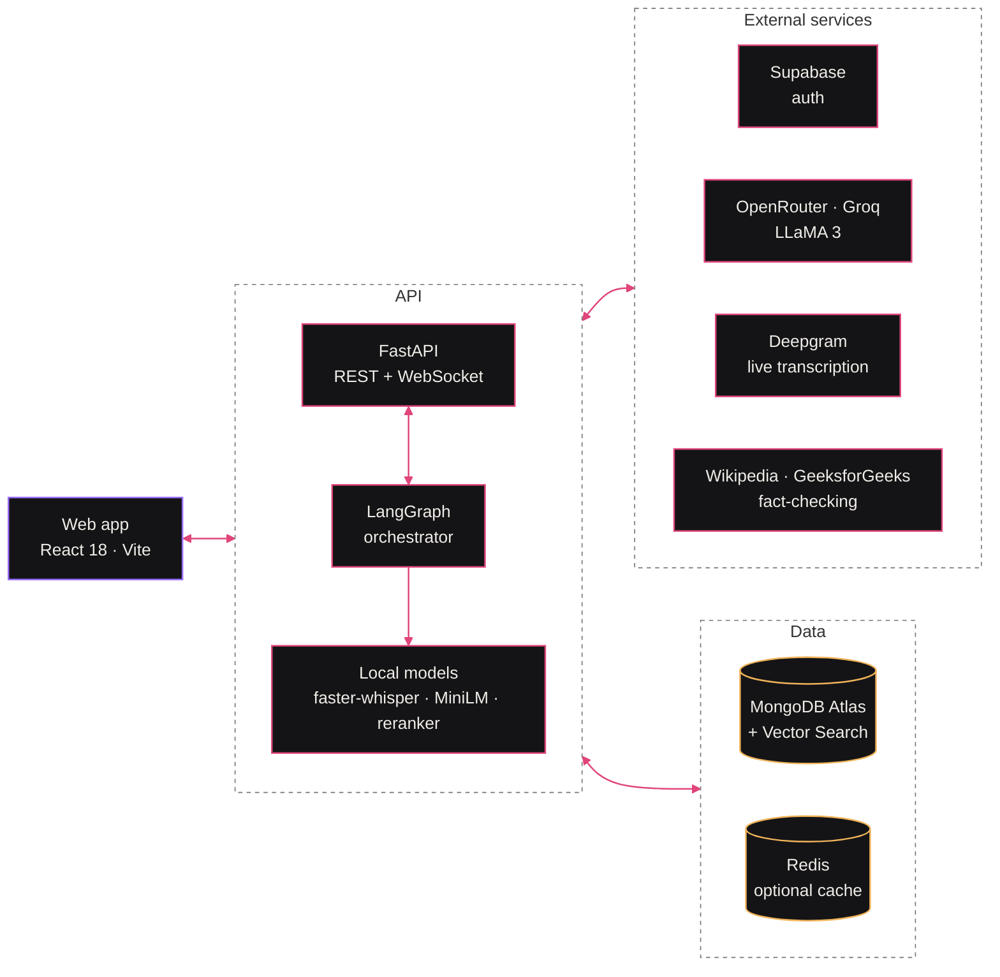

<a id="readme-top"></a>

<div align="center">



<br/>

<a href="https://github.com/MohitNilvarn/Teachers-Assistance-Platform/actions/workflows/ci.yml"></a>
<a href="LICENSE"></a>


<a href="CONTRIBUTING.md"></a>

<h3>Turn every lecture into grounded study material.</h3>

<p>TAP transcribes a lecture, retrieves what matters from the teacher's own course material,<br/>and generates notes, assignments, and flashcards that stay faithful to what was actually taught.</p>

<p>
  <a href="#how-it-works"><b>How it works</b></a>&nbsp;&nbsp;·&nbsp;&nbsp;
  <a href="#features"><b>Features</b></a>&nbsp;&nbsp;·&nbsp;&nbsp;
  <a href="#architecture"><b>Architecture</b></a>&nbsp;&nbsp;·&nbsp;&nbsp;
  <a href="#quick-start"><b>Quick start</b></a>&nbsp;&nbsp;·&nbsp;&nbsp;
  <a href="CONTRIBUTING.md"><b>Contributing</b></a>
</p>

</div>

<!-- Demo: record a 15–30s walkthrough, save it as docs/assets/demo.gif, and add it here. -->


## Why TAP

Teachers spend hours outside the classroom turning lectures into notes, practice questions, and revision material, and keeping that content aligned with what was actually taught is hard. TAP automates the loop: record or upload a lecture, attach your slides and readings, and get study material grounded in *your* course rather than the open internet.

<table>
  <tr>
    <td width="33%" valign="top">
      <h3>Notes</h3>
      Structured sections with formulas, derivations, and worked examples, with math rendered by KaTeX.
    </td>
    <td width="33%" valign="top">
      <h3>Assignments</h3>
      16–24 subjective questions spanning difficulty levels and question types.
    </td>
    <td width="33%" valign="top">
      <h3>Flashcards</h3>
      25–35 categorized cards built for fast revision.
    </td>
  </tr>
</table>


## How it works



1. **Capture.** Record live in the browser with real-time Deepgram transcription, or upload MP3/WAV for local `faster-whisper` transcription. Teachers attach PDF, DOCX, or PPTX material to each unit.
2. **Index.** Material is split into parent–child chunks and embedded locally with `all-MiniLM-L6-v2` into MongoDB Atlas Vector Search.
3. **Retrieve.** Queries are expanded with HyDE and decomposition, searched with dense vectors plus BM25, and re-ranked by a cross-encoder, all scoped to the lecture.
4. **Generate.** A LangGraph workflow summarizes the transcript, compresses the retrieved context with citations, cross-checks facts against Wikipedia and GeeksforGeeks, and asks the LLM for structured JSON.
5. **Evaluate.** Every output is scored on seven quality dimensions and stored alongside the content for teachers to review.


## Features

<table>
  <tr>
    <td width="50%" valign="top">

#### For teachers

- **Live lecture capture** with real-time transcription
- **Batch uploads** of audio and PDF, DOCX, or PPTX material
- **One-click generation** of notes, assignments, and flashcards
- **Unit-based course management** with review and editing of generated content

</td>
    <td width="50%" valign="top">

#### For students

- **Automatic enrollment** by academic year
- **Readable notes** with LaTeX math rendering
- **Practice assignments** across difficulty levels
- **Flashcards** for quick revision
- **An AI study assistant** that answers questions from the course material

</td>
  </tr>
</table>


## Architecture



### Tech stack

<p>
  
  
  
  
  
  
  
  
  
  
  
</p>

<details>
<summary><b>Full stack breakdown</b></summary>
<br/>

| Layer | Technology |
|---|---|
| **Frontend** | React 18, TypeScript, Tailwind CSS, Vite, KaTeX |
| **Backend** | Python 3.11, FastAPI |
| **AI orchestration** | LangGraph, LangChain |
| **LLM** | OpenRouter (LLaMA 3 70B) for content generation · Groq (LLaMA 3.1 8B Instant) for the chatbot |
| **Speech-to-text** | Deepgram (real-time streaming), `faster-whisper` (local batch transcription) |
| **Embeddings & re-ranking** | `sentence-transformers` (`all-MiniLM-L6-v2`, cross-encoder), run locally |
| **Database & vector store** | MongoDB Atlas + Atlas Vector Search, Redis (optional cache) |
| **Authentication** | Supabase, with role-based access for teachers and students |

</details>


## Quick start

> [!NOTE]
> **Prerequisites:** Python 3.11 · Node.js 22 · FFmpeg · Tesseract OCR · a MongoDB Atlas cluster · API keys for Supabase, OpenRouter, Groq, and Deepgram.

**1. Start the API**

```bash
cd apps/api
python -m venv .venv
source .venv/bin/activate          # Windows: .venv\Scripts\activate
pip install -r requirements-dev.txt
cp .env.example .env               # then add your keys
uvicorn app.main:app --reload --port 8000
```

**2. Start the web app** in a second terminal

```bash
cd apps/web
npm install
cp .env.example .env.local
npm run dev
```

| Service | URL |
|---|---|
| **Web app** | http://localhost:5173 |
| **API docs** | http://localhost:8000/docs |

**3. Run the checks.** Run `pytest` in `apps/api` and `npm run lint && npm run build` in `apps/web`. CI runs both on every pull request.

Every setting is documented in [`apps/api/.env.example`](apps/api/.env.example) and [`apps/web/.env.example`](apps/web/.env.example).


## Project structure

```text
.
├── apps/
│   ├── api/            FastAPI backend (Python 3.11)
│   │   ├── app/        ai/ · api/v1/ · core/ · db/ · models/ · schemas/ · services/
│   │   ├── scripts/    Maintenance and diagnostic scripts
│   │   └── tests/      pytest suite
│   └── web/            React + Vite frontend (TypeScript)
│       └── src/        components/ · lib/ · pages/ · types/
├── docs/               Architecture, workflow, and README assets
└── .github/            CI workflow and PR template
```

| Document | What's inside |
|---|---|
| [`CONTRIBUTING.md`](CONTRIBUTING.md) | Full directory breakdown, conventions, and PR checks |
| [`docs/ARCHITECTURE.md`](docs/ARCHITECTURE.md) | System architecture deep-dive |
| [`docs/PROJECT_WORKFLOW.md`](docs/PROJECT_WORKFLOW.md) | End-to-end project workflow |
| [`docs/DOCUMENT_UPLOAD_GUIDE.md`](docs/DOCUMENT_UPLOAD_GUIDE.md) | Uploading course material |


## Security

- **Authentication.** Sign-up and login are handled by Supabase, and sessions use Supabase-issued JWTs.
- **Role-based access.** Teacher and student routes are separated by role.
- **Scoped retrieval.** Vector search is limited to the lecture being generated, so outputs only draw on relevant material.

## Contributing

Contributions are welcome. Read [`CONTRIBUTING.md`](CONTRIBUTING.md) for the layout and conventions, then branch from `prod` (`feature/…`, `fix/…`, or `chore/…`) and open a focused pull request. For larger changes, please open an issue first.

## License

Released under the [MIT License](LICENSE).

Built on [Groq](https://groq.com/), [OpenRouter](https://openrouter.ai/), [Deepgram](https://deepgram.com/), [Hugging Face](https://huggingface.co/), [MongoDB Atlas](https://www.mongodb.com/atlas), and [Supabase](https://supabase.com/).

<div align="center">

<br/>

<sub><a href="#readme-top">Back to top ↑</a></sub>


</div>
