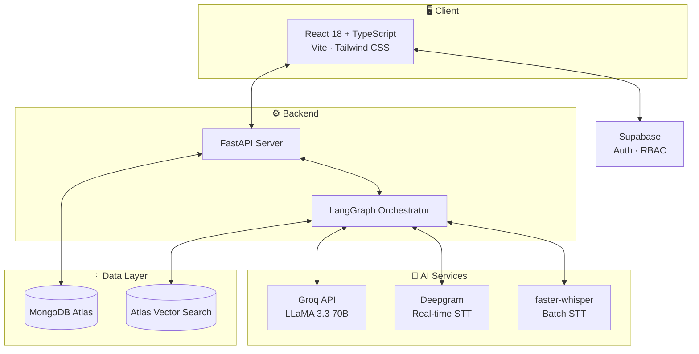
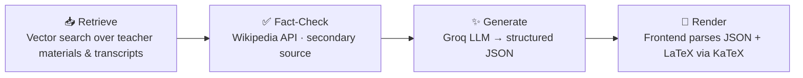

# Teacher Assistance Platform (TAP)

<div align="center">


[](https://git.io/typing-svg)

<br/>

[](https://reactjs.org/)
[](https://www.typescriptlang.org/)
[](https://fastapi.tiangolo.com/)
[](https://www.python.org/)
[](https://tailwindcss.com/)
[](https://www.mongodb.com/)
[](https://www.langchain.com/langgraph)
[](https://groq.com/)
[](https://supabase.com/)
[](#contributing)

<br/>


<br/><br/>

An AI-powered platform that transforms lectures and teacher materials into grounded, high-quality study content (notes, assignments, and flashcards) using a production-grade Retrieval-Augmented Generation (RAG) pipeline.

[Problem](#problem-statement) • [Solution](#the-solution) • [Demo](#demo) • [Features](#key-features) • [Architecture](#architecture) • [RAG Pipeline](#rag-pipeline) • [Getting Started](#getting-started) • [Docs](#documentation) • [Security](#security) • [Contributing](#contributing)

</div>

---

<a id="problem-statement"></a>
## 🎯 Problem Statement

Educators spend a significant amount of their time outside the classroom manually creating study materials. From drafting lecture notes to formulating assignments and creating revision flashcards, this repetitive process detracts from the time they could spend interacting with students or improving their teaching methods. Furthermore, ensuring that all generated content is accurately aligned with the specific curriculum and materials taught in class is challenging.

<a id="the-solution"></a>
## 💡 The Solution: TAP

**TAP (Teacher Assistance Platform)** automates the creation of study materials. By simply recording a live lecture or uploading pre-recorded audio and reference documents, the platform automatically generates:

- 📝 **Detailed Notes**: Structured sections with formulas, derivations, and examples.
- 📋 **Assignments**: 16–24 subjective questions across varying difficulties and types.
- 🗂️ **Flashcards**: 25–35 categorized cards for quick revision.

Students can enroll in their academic year and instantly access these high-quality, AI-generated resources, while teachers can save hours of manual effort.

---

<a id="demo"></a>
## 🎬 Demo

> 📌 *Add a short screen recording here showing a lecture being recorded, content being generated, and the student view in action — it's the single highest-impact addition you can make to this README.*

<details>
<summary><strong>How to add a demo GIF</strong></summary>

<br/>

1. Record a 15–30s walkthrough with a tool like <a href="https://www.cockos.com/licecap/">LiceCap</a>, <a href="https://github.com/phw/peek">Peek</a>, or <a href="https://getkap.co/">Kap</a>.
2. Save it as `docs/demo.gif` (keep it under ~10MB for fast loading).
3. Replace this section with:
   ```markdown
   
   ```

</details>

---

<a id="key-features"></a>
## 🚀 Key Features

<table>
<tr>
<td valign="top" width="50%">

### 👩‍🏫 For Teachers
- **Live Lecture Recording** — record directly from the browser with real-time transcription powered by Deepgram.
- **Batch Uploads** — upload pre-recorded audio (MP3/WAV) and reference materials (PDF, DOCX, PPTX).
- **Automated Content Generation** — one-click generation of Notes, Assignments, and Flashcards based *strictly* on the uploaded materials and lecture transcript.
- **Content Management** — manage courses by units, review AI-generated content, and optionally edit them.

</td>
<td valign="top" width="50%">

### 🎓 For Students
- **Instant Access** — automatically enroll by academic year to get access to all relevant subjects.
- **Rich Interactive Content** — beautifully formatted notes with LaTeX math rendering (via KaTeX).
- **Practice Assignments** — 16–24 subjective questions across varying difficulty levels and types.
- **Study Flashcards** — 25–35 categorized cards for quick revision.

</td>
</tr>
</table>

---

<a id="architecture"></a>
## 🏗️ Architecture & Tech Stack

TAP is built on a modern, scalable architecture featuring a React frontend, a FastAPI backend, and an advanced AI orchestrator using LangGraph.



| Layer | Technology |
|---|---|
| **Frontend** | React 18, TypeScript, Tailwind CSS, Vite |
| **Backend** | Python, FastAPI |
| **AI Orchestration** | LangGraph, LangChain |
| **LLM** | Groq API (LLaMA 3.3 70B) for blazing-fast inference |
| **Speech-to-Text** | `faster-whisper` (local batch transcription), Deepgram (real-time streaming) |
| **Embeddings** | HuggingFace `sentence-transformers/all-MiniLM-L6-v2` (local) |
| **Database & Vector Store** | MongoDB Atlas + Atlas Vector Search |
| **Authentication** | Supabase (Role-based: Teacher vs. Student) |

<a id="rag-pipeline"></a>
### 🔁 AI Generation Pipeline (RAG)



1. **Retrieve**: Vector search extracts the most relevant chunks from teacher-uploaded materials and transcripts.
2. **Fact-Check**: Wikipedia API is consulted for fact verification (secondary source).
3. **Generate**: Groq LLM strictly uses the retrieved context to generate notes, assignments, and flashcards in structured JSON format.
4. **Render**: Frontend parses the JSON and renders rich text and LaTeX equations.

---

## 📁 Repository Layout

```text
apps/
  api/        # FastAPI backend (Python)
  web/        # Vite + React frontend
docs/         # Architecture, Workflow, and detailed Operational docs
```

---

<a id="getting-started"></a>
## 🛠️ Getting Started

### Prerequisites
- Python 3.10+
- Node.js 18+
- FFmpeg (for audio processing)
- MongoDB Atlas cluster
- API Keys: Supabase, Groq, (Optional) HuggingFace

### 1. Backend (FastAPI) Setup

```bash
cd "apps/api"
python -m venv .venv
```

<details>
<summary>Activate the virtual environment</summary>

<br/>

**Windows:**
```bash
.venv\Scripts\activate
```

**Mac/Linux:**
```bash
source .venv/bin/activate
```

</details>

```bash
pip install -r requirements.txt
```

**Environment Variables:**
Create a `.env` file at the root of the repository. (Refer to the `.env.example` if available or the `ARCHITECTURE.md` docs).

**Run the Server:**
```bash
uvicorn app.main:app --reload --port 8000
```
- API Docs: `http://localhost:8000/docs`

### 2. Frontend (Vite + React) Setup

```bash
cd "apps/web"
npm install
npm run dev
```
- Application: `http://localhost:5173`
- Environment: Set `VITE_API_URL` in `apps/web/.env.local` if necessary.

---

<a id="documentation"></a>
## 📚 Documentation

| Doc | Description |
|---|---|
| [`ARCHITECTURE.md`](docs/ARCHITECTURE.md) | System architecture deep-dive |
| [`PROJECT_WORKFLOW.md`](docs/PROJECT_WORKFLOW.md) | Complete project workflow |
| [`DOCUMENT_UPLOAD_GUIDE.md`](docs/DOCUMENT_UPLOAD_GUIDE.md) | Document upload guide |
| [`UPLOAD_TROUBLESHOOTING.md`](docs/UPLOAD_TROUBLESHOOTING.md) | Troubleshooting upload issues |

---

<a id="security"></a>
## 🔒 Security

- JWT-based authentication via Supabase.
- Strict Role-Based Access Control (RBAC) ensuring students cannot access teacher portals and vice versa.
- Lecture-scoped vector retrieval ensuring AI only uses materials relevant to the specific lecture.

---

<a id="contributing"></a>
## 🤝 Contributing

Contributions are welcome!

1. Fork the repository.
2. Create a feature branch: `git checkout -b feature/your-feature`.
3. Commit your changes: `git commit -m "Add your feature"`.
4. Push to the branch: `git push origin feature/your-feature`.
5. Open a Pull Request.

For major changes, please open an issue first to discuss what you'd like to change.

## 📄 License


> Add your project's license here (e.g., MIT, Apache 2.0, GPL-3.0).

## 🙏 Acknowledgments

- [Groq](https://groq.com/) for blazing-fast LLaMA 3.3 70B inference.
- [Deepgram](https://deepgram.com/) for real-time speech-to-text.
- [HuggingFace](https://huggingface.co/) for the `sentence-transformers` embedding models.
- [MongoDB Atlas](https://www.mongodb.com/atlas) for vector search and data storage.
- [Supabase](https://supabase.com/) for authentication and RBAC.

<div align="center">

<br/>

[⬆ Back to Top](#teacher-assistance-platform-tap)


</div>